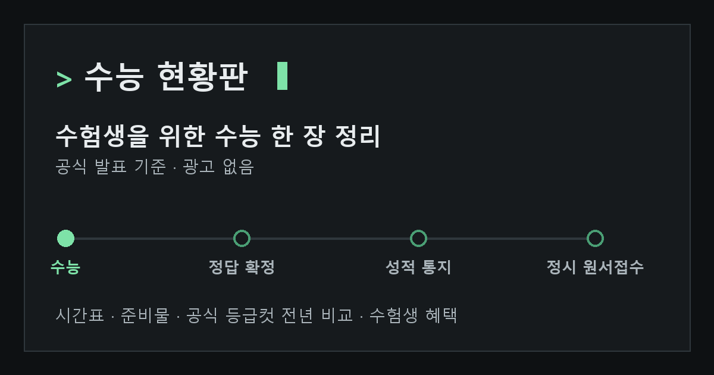

# 수능 현황판



수험생을 위한 **대학수학능력시험(수능) 전용 정적 웹사이트**입니다. 2027학년도 수능 시즌(2026년 11월)에 잠시 공개했다가 운영을 마쳤고, 지금은 코드와 데이터 구조를 포트폴리오로 남겨 둡니다.

> 운영 종료: 2026-11-17 · 사이트 주소는 닫혀 있습니다. 아래 "로컬에서 보기"로 그대로 열어볼 수 있습니다.

## 무엇을 했나

- **시기에 따라 바뀌는 첫 화면** — 날짜와 시각으로 단계를 계산해 화면 순서를 바꿉니다.
  - 시험 전: "수능까지 N일 · 입실 08:10까지", 시간표·준비물
  - 시험 당일: 지금 진행 중인 교시 표시
  - 시험이 끝난 저녁: 정답 확인·예상 등급컷 바로가기(공식·입시기관 링크), 작년 공식 등급컷
  - 결과 대기: 성적 통지까지 N일, 수험생 혜택
  - 결과 발표 후: 올해 공식 등급컷을 맨 위로, 정시 원서접수 일정
- **화면 배치 근거는 검색 데이터** — 지난 시즌 검색 추이(Google 트렌드)를 보면 관심의 중심은 등급컷(시간표의 약 7배, 시험 당일 최고)이고, 시간표·준비물은 전날에만 반짝, 할인 정보는 다음 날부터 일주일, 정시는 결과일과 원서 마감 직전에 몰렸습니다. 이 순서대로 배치했습니다.
- **공식 등급컷 전년 비교** — 36과목 등급 구분점수·인원 비율, 과목 자동 순환판, 누르면 상세 비교
- **수험생 혜택 모음** — 분류·출처·기간·조건을 같은 틀로 정리
- 다크/라이트 모드(글자 대비는 웹 접근성 기준 4.5 이상), 휴대폰 화면, 공유 미리보기 이미지

## 데이터 원칙

- 숫자는 **공식 발표 원문**(한국교육과정평가원·교육부)을 사람이 확인해 옮겼습니다. 블로그·학원 자료는 쓰지 않았습니다.
- 숫자만 옮겨 표·그래프로 다시 구성했고, 각 수치의 출처(기관·자료명·확인일·링크)를 표시합니다.
- 입시기관의 예상 등급컷 같은 추정치는 싣지 않고 링크로만 안내합니다.
- 단위를 섞지 않습니다: 비율 차이 %p, 인원 명, 점수 점.
- 자동 수집이 아니라 수동 갱신입니다. 각 기관과 관계가 없습니다.

## 구조

```
index.html          → board/ 로 이동
board/              화면 (HTML · CSS · JavaScript, 프레임워크 없음)
  api.js            데이터를 읽는 유일한 통로
  board.js          화면 그리기 · 시기별 단계 계산
  og.png            공유 미리보기 이미지
data/v1/            화면이 읽는 정적 JSON API
  index.json        사이트·시험 정보
  summary.json      최근 두 해 비교(미리 계산)
  exams/csat.json   수능 전체 수치(누를 때만 읽음)
  guides/*.json     시험 안내(시간표·일정·혜택)
  schedule.json · sources.json
```

모든 수치는 "숫자 하나 = 기록 한 줄"(연도·지표·과목·등급·값·출처) 형식으로 관리하고, 빌드할 때 등급 비율 합계·출처 등록·이용 조건 등을 검증한 뒤 이 JSON을 만들었습니다. 지난 시즌(2026학년도) 일정과 데이터로 화면을 다시 재생해 보는 방식으로 날짜별 동작을 확인했습니다.

## 로컬에서 보기

```bash
python -m http.server 8766
```

http://127.0.0.1:8766/board/ 를 엽니다(JSON을 불러오므로 파일을 직접 열지 말고 로컬 서버로 여세요).

날짜를 바꿔 보려면 `?asOf=`를 붙입니다.

- 시험 끝난 저녁: http://127.0.0.1:8766/board/?asOf=2026-11-19T19:00
- 결과 발표 후: http://127.0.0.1:8766/board/?asOf=2026-12-11T09:00
